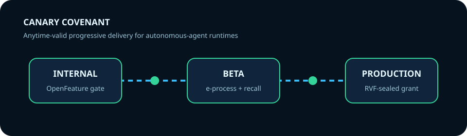
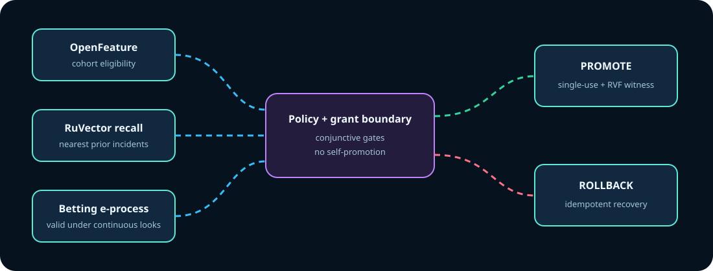

<p align="center"></p>

<p align="center">
  
  &nbsp;&nbsp;&nbsp;
  
</p>
<p align="center"><sub>Official upstream vectors; see <a href="docs/assets/marks/ATTRIBUTION.md">attribution and trademark notes</a>.</sub></p>

# Canary Covenant

Canary Covenant is a 24-crate Rust control plane for progressively delivering autonomous-agent runtime changes. It combines enterprise flag evaluation, historical incident recall, anytime-valid sequential evidence, bounded promotion authority, and tamper-evident rollout receipts.

## Why

Ordinary canaries answer which cohort receives a release. They do not keep statistical guarantees valid while operators continuously inspect data, lower exposure when a similar incident is recalled, or prove that a promotion receipt was not rewritten. Canary Covenant does all three in one tested saga.

## Quickstart

```bash
cargo run --locked -p cc-cli -- evaluate --variant combined
cargo run --locked -p cc-cli -- evaluate --variant combined --harmful
```

Healthy input produces Promote, a consumed one-use grant, four executed integrations, and a verified RVF witness. Harmful input produces Rollback and two idempotent recovery actions.

<p align="center"></p>

## Composition

| Ingredient | Executed role | Pin |
| --- | --- | --- |
| OpenFeature Rust SDK | Official provider registration, evaluation context, typed flag resolution | 0.3.0 / 4ad8924 |
| RuVector core | In-process incident-vector insert and nearest-neighbor search | 2.4.0 / repository 46d816d |
| RVF crypto | SHAKE-256 action binding and witness-chain creation/verification | 0.2.0 / repository 46d816d |
| Anytime-valid e-process | Continuous rollout evidence with a Ville threshold | arXiv:2210.01948 |

## Workspace and evidence

Every crate responsibility, typed API, caller, ADR/DDD anchor, test, and acceptance criterion is in [architecture](docs/architecture.md). The dependency direction is domain → adapters/evidence → policy/recovery → orchestrator → API/CLI; evaluation is downstream only.

```bash
cargo fmt --all --check
cargo clippy --workspace --all-targets --all-features -- -D warnings
cargo test --workspace --all-targets --all-features --locked
bash tests/e2e.sh
```

See the [evidence index](docs/evidence/README.md), [integration matrix](docs/integration-matrix.md), [ADRs](docs/adrs/README.md), [DDD model](docs/ddd/README.md), [research](docs/research.md), and [implementation contract](docs/implementation-contract.md).

## Reproducible evaluation

Five release-mode runs used the same 30-observation healthy fixture. Median latency is descriptive only; the capability columns are the acceptance signal.

| Variant | Median latency | Decision | Verified witness | Grant consumed |
| --- | ---: | --- | --- | --- |
| Combined | 15.8 ms | Promote | yes | yes |
| No OpenFeature | 15.5 ms | Hold | yes | no |
| No RuVector | 2.8 ms | Hold | yes | no |
| No RVF | 16.2 ms | Hold | no | no |
| No e-process | 15.6 ms | Hold | yes | no |
| Enterprise-only | 3.7 ms | Hold | no | no |
| Ruvnet-only | 14.5 ms | Hold | yes | no |

The harmful fixture deterministically produced `Rollback`, two recovery actions, and a verified witness. Raw per-run data is in [`docs/evidence/raw/benchmark.csv`](docs/evidence/raw/benchmark.csv).

## Maturity and limits

Research-grade control-plane reference, not a production traffic mutator. The deterministic local OpenFeature provider exercises the official SDK contract but is not a remote flag service. RuVector 2.4.0 is exercised in-process because that release does not publicly export its persistent `DbOptions`; persistence belongs to the append-only evidence boundary. Four-feature incident embeddings and synthetic fixtures are transparent and reproducible, not universal semantic or causal models. The RVF witness proves tamper evidence inside the artifact, not an external timestamp. Single-process grants demonstrate state-machine invariants, not distributed consensus. The pinned RuVector dependency transitively includes unmaintained `bincode 2.0.1` (`RUSTSEC-2025-0141`); there is no reported vulnerability or safe upstream upgrade, so the exception is explicit in `deny.toml`.

## License

MIT. Upstream dependencies retain their own licenses; see [research](docs/research.md).
